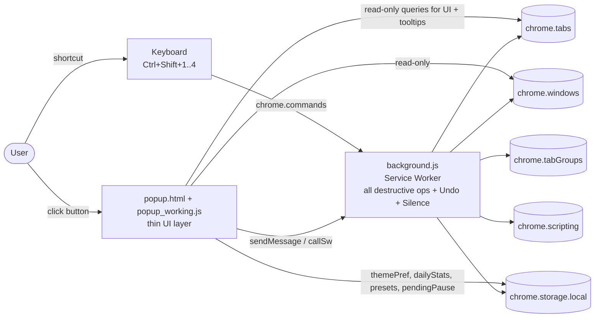
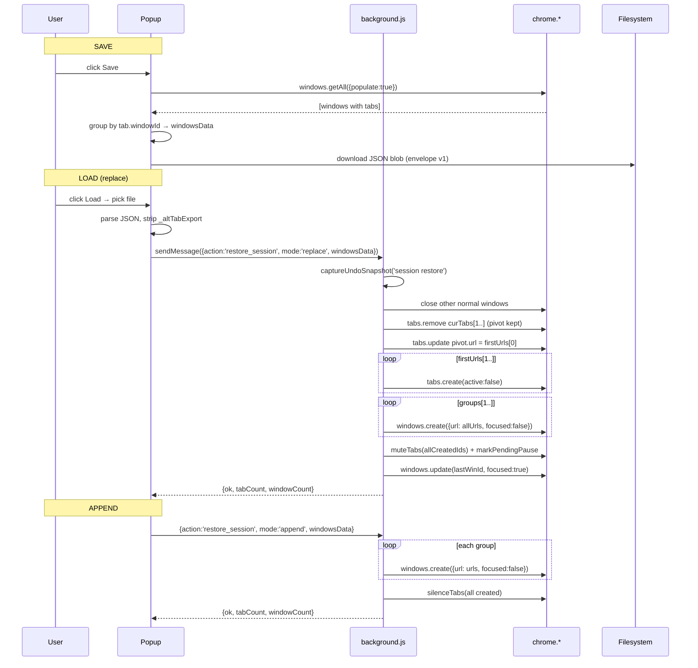
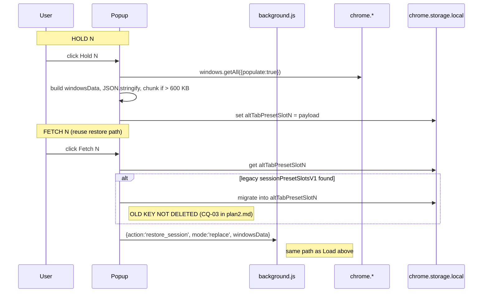
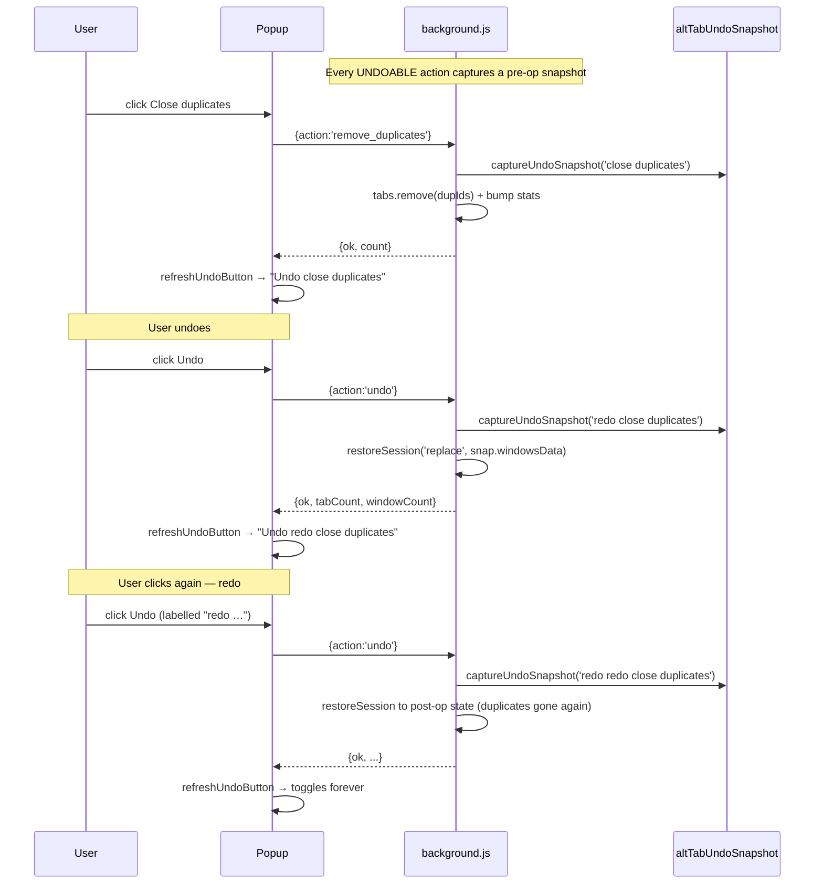
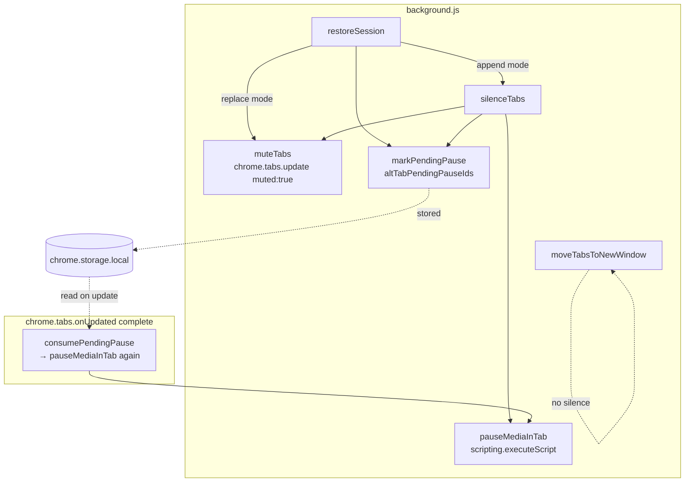
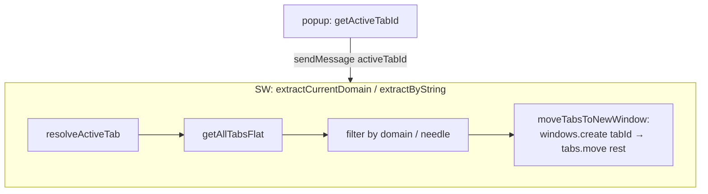
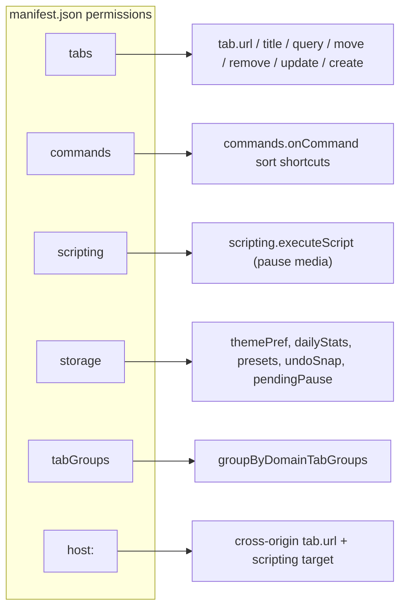

# DIAGRAMS.md — Alt Tab mermaid diagrams

## 1. High-level architecture



## 2. Session Save / Load / Append (current)



## 3. Hold / Fetch (preset snapshot)



## 4. Undo / Redo toggle



## 5. Silence (mute + pause) subsystem



`moveTabsToNewWindow` (extract, regroup, extract-by-string) intentionally does NOT
touch mute state. Silencing is scoped to Session Restore only.

## 6. Extract current domain / by string — OK (no mute)



Extract preserves mute/media state — YouTube keeps playing after it moves.

## 7. Permissions map



(`activeTab` permission was removed — `tabs` + `<all_urls>` cover everything.)

## 8. Storage keys

```mermaid
flowchart LR
  subgraph Legacy["Legacy (pre-split)"]
    L1[sessionPresetSlotsV1:<br/>Array of 4 slots]
  end

  subgraph Current["Current per-slot keys"]
    C1[altTabPresetSlot0..3]
  end

  subgraph New["Added by recent waves"]
    U[altTabUndoSnapshot<br/>{v:1, label, tabCount, windowCount, savedAt, j|jp}]
    P[altTabPendingPauseIds<br/>{[tabId]: timestamp}]
    D[altTabDailyCloseStats<br/>{day, dupTabs, domainTabs}]
    T[themePref]
  end

  L1 -.migrateLegacyPresetsOnce.-> C1
  L1 -.deleted after success.-> X[gone]
```

---

See `plan2.md` for findings and prioritised fixes, `AGENTS.md` for text-form codepaths.
