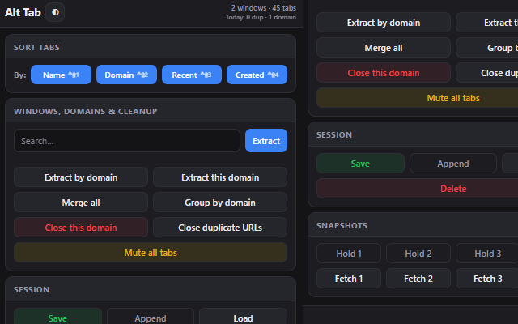

# Alt Tab

**Chrome Extension (Manifest V3)** — tools to sort tabs, reorganize windows, save and restore sessions, and bulk-clean duplicates or whole domains — without leaving one popup.

[](https://opensource.org/licenses/MIT)



*(UI may vary slightly by Chrome version and theme.)*

---

## Features

| Area | What you get |
|------|----------------|
| **Jump** | Search any tab by title or URL (**Ctrl+K** focuses the field). Arrow keys + Enter to focus the tab and close the popup. |
| **Sort** | Per window: **Name**, **Domain**, **Recent** (last visited), **Created**. Same actions via global shortcuts (**Ctrl+Shift+1 … 4**). |
| **Windows & domains** | **Extract** tabs matching a string into a new window; **Extract this domain** / **Extract by domain**; **Merge all** into the current window; **Group by domain** (Chrome Tab Groups). |
| **Cleanup** | **Close this domain** and **Close duplicate URLs** — two-step confirm; optional daily counters in the header. **Mute all tabs** across windows. |
| **Session** | **Save** session JSON; **Load** replaces with `http(s)` URLs from file; **Append** opens additional windows. **Delete** closes all tabs (with confirmation and automatic JSON backup download first). |
| **Snapshots** | **Hold 1–4** / **Fetch 1–4** — store full-session snapshots in `chrome.storage` and restore like Load. |
| **Copy MD** | Copy all tabs as Markdown lists grouped by window. |
| **Undo** | After destructive or large bulk ops, undo restores the previous layout (with redo chaining for the same slot). |

Session restore (**Append**) mutes tabs and queues media pause when pages finish loading — so restored sessions don’t start blasting audio.

---

## Install (developer / unpacked)

1. Clone this repository.
2. Open **Chrome → Extensions → Developer mode**.
3. **Load unpacked** and select the `alt_tab` folder (the directory that contains `manifest.json`).

There is no build step — the shipped extension files are plain HTML/CSS/JS.

---

## Keyboard shortcuts

Defined in [`alt_tab/manifest.json`](alt_tab/manifest.json) (`chrome.commands`):

| Shortcut (default) | Action |
|--------------------|--------|
| **Ctrl+Shift+1** | Sort tabs by name |
| **Ctrl+Shift+2** | Sort by domain |
| **Ctrl+Shift+3** | Sort by last visit |
| **Ctrl+Shift+4** | Sort by creation time |

You can remap these under **Chrome → Extensions → Alt Tab → keyboard shortcuts**.

---

## Session file format

Saved files use a small envelope (`formatVersion`, `savedAt`) and a `windows` map of URL lists. The loader accepts both current **v2** and legacy **v1** shapes. Non-`http`/`https` URLs are skipped when restoring.

---

## Permissions (why)

| Permission | Purpose |
|------------|---------|
| `tabs` | List, move, mute, activate tabs; merge windows |
| `commands` | Global sort shortcuts |
| `scripting` | Pause video/audio after session restore (`executeScript`) |
| `storage` | Theme, presets, undo snapshot, pending pause IDs, daily stats |
| `tabGroups` | Group by domain |
| `<all_urls>` | Read tab URLs and target scripts for media pause |

---

## Development

```bash
npm install
npm run lint
```

`npm run lint:fix` applies ESLint auto-fixes where possible.

---

## Project layout

```
alt_tab/
├── manifest.json     # MV3 manifest, commands, permissions
├── background.js     # Service worker: mutations, undo, silence, session restore
├── popup.html        # Popup UI
├── popup.css         # Theming (system / dark / light)
├── popup_working.js  # Popup → chrome.runtime.sendMessage → background
└── icon*.png
```

Architectural notes and diagrams live in [`AGENTS.md`](AGENTS.md) and [`DIAGRAMS.md`](DIAGRAMS.md).

---

## License

MIT — see [`package.json`](package.json) `license` field.
